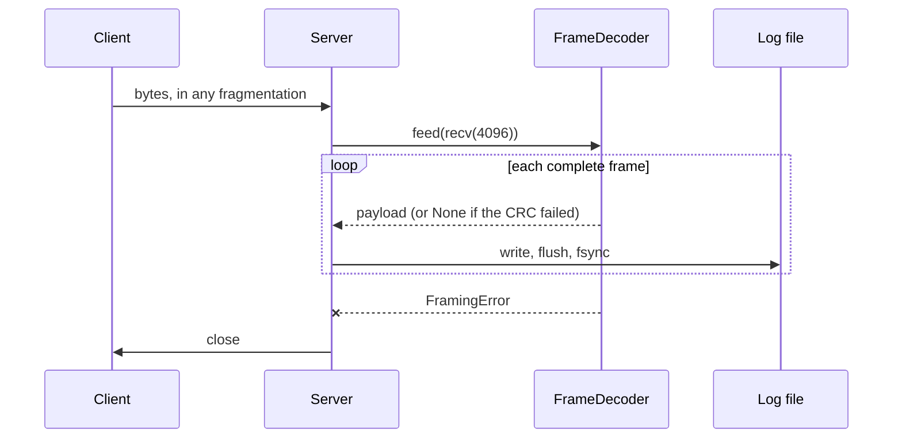

# py-frame-relay

The idea behind this project is simple: TCP doesn't deliver messages. It delivers bytes.
If a client sends three frames, your server might read them all in one `recv()`,
or in thirty, or get half a header and nothing else for a while. Code that assumes one
read is one message passes every test on localhost and then falls over on a real network.

py-frame-relay is a small telemetry collector that doesn't make that assumption. It runs
on one thread and uses only the standard library. It puts the frames back together, checks that each one arrived
intact, and writes it to disk before it moves on.

```
docker compose up --build        # or: python -m py_frame_relay --port 9000 --log telemetry.log
```

## What a frame looks like

```
 0       4       8       12
 +-------+-------+-------+-----------+
 | PYFR  |  len  | crc32 |  payload  |    big-endian, len <= 65536
 +-------+-------+-------+-----------+
```

The first four bytes tell the server it's still reading a real frame. The length tells it
where the frame stops. The CRC tells it whether the payload got through unharmed.

Each client gets its own `FrameDecoder`, which holds on to whatever has arrived and only
hands back complete frames. A single `selectors` loop (`epoll` on Linux) watches all the
sockets, so many clients share one thread and there are no locks to reason about.



## When something is wrong

Not every error is equally bad, and the server treats them differently.

If the CRC is wrong, the payload got damaged but the header was fine. The server still
knows where the next frame begins, so it counts the bad one, skips it, and keeps going.

If the magic bytes are wrong, or the length is absurd, the server has lost its place in
the stream. Anything it read after that would be a guess, so it closes that client and
leaves everyone else alone. The 64 KiB cap on length is there so a bad header can't talk
the server into buffering gigabytes.

If the disk fails, the server stops. The client did nothing wrong, and a collector that
quietly loses data is worse than one that's honest about being broken.

## The trade-off

The server calls `fsync` after every frame, so anything it has accepted survives a crash.
That's also the slow part. `fsync` blocks the only thread, so a slow disk slows every
client down. Syncing in batches would be faster, but a crash could then lose the last few
frames. This project takes the safe option because it's easier to reason about. There is also no
authentication and no backpressure, and it only uses one core.

## Development

```
pip install -e ".[dev]" && ruff check && ruff format --check && pytest -v
```

The tests send a frame one byte at a time, fire 50-frame bursts from several clients at
once, flip a bit in a payload, put a garbage client next to a healthy one, and check that
`fsync` really gets called.
