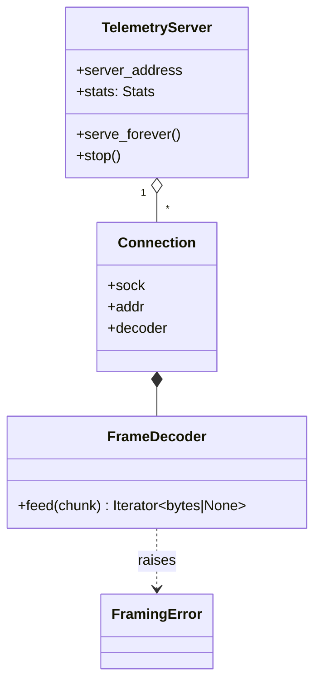
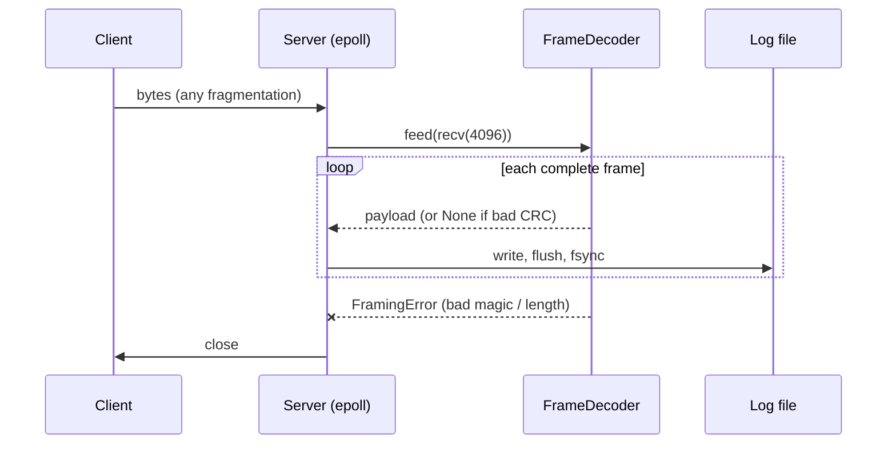

# py-frame-relay

Single-threaded TCP telemetry collector. Stdlib only. Frames are CRC-checked and fsynced to disk.

```
docker compose up --build        # or: python -m py_frame_relay --port 9000 --log telemetry.log
```

## Wire format

```
 0       4       8       12
 +-------+-------+-------+-----------+
 | PYFR  |  len  | crc32 |  payload  |    big-endian, len <= 65536
 +-------+-------+-------+-----------+
```

## Structure



## Per-read flow



| Input | Result |
|---|---|
| Partial frame | buffered until complete |
| Many frames in one read | all decoded |
| Bad CRC | frame counted and skipped |
| Bad magic / oversize length | client disconnected |

## Trade-offs

- fsync per frame is durable but blocks the single thread, so a slow disk stalls every client.
- No locks, but also one core.
- No auth or backpressure.

## Dev

```
pip install -e ".[dev]" && ruff check && ruff format --check && pytest -v
```
